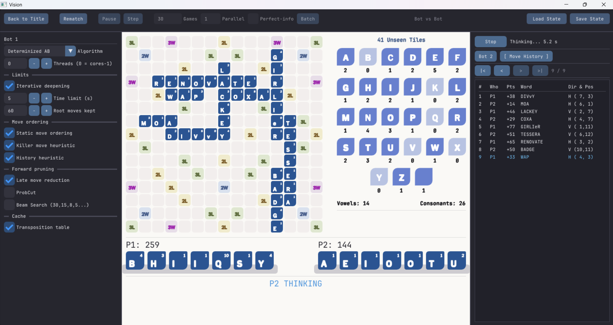
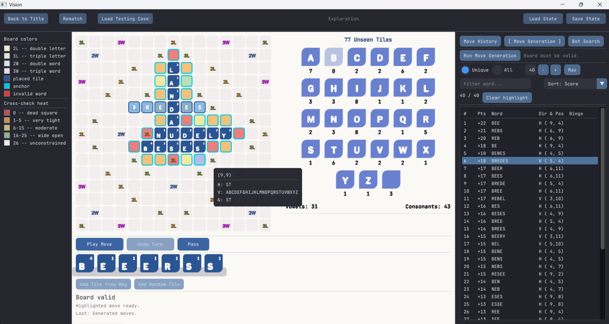

# Crossplay Analyzer

A Crossplay (Scrabble-variant) engine and analysis application in C++ — with GADDAG move generation, alpha-beta and MCTS search, and an ImGui frontend for exploring positions and simulating games.

Built as a sandbox for studying adversarial search under imperfect information, and to answer the question: *why does the NYT Crossplay bot play the way it does?*



---

## What's here

- **GADDAG engine** — Move generation via Steven Gordon's GADDAG data structure (811,989 nodes, 55M hops/sec on a mid-range laptop). Cross-check masks precomputed per position.
- **Search** — Determinized alpha-beta with LMR, ProbCut, killer/history heuristics, beam search, transposition table. MCTS with configurable rollouts. Both parallelized.
- **Batch simulation** — Multi-threaded Greedy vs. Greedy (or any bot pairing). Every turn writes ~60 diagnostic fields to CSV; a summary pass computes win rates, regret vs. Greedy, leave-value calibration.
- **Vision UI** — Three modes: Exploration (sandbox), Player vs. Bot, Bot vs. Bot (with batch runner). Real-time board, tile bag, move generation, and search configuration.
- **Test suite** — 19 test files, 0 failures. Verifies move generation, scoring, search correctness, and GADDAG structural invariants.

---

## Building

### Prerequisites

- **CMake** 3.20 or newer
- **C++20** compiler (MSVC 19.16+, GCC 11+, or Clang 14+)
- **SDL2** — development libraries
- **Dear ImGui** — vendored at `imgui/` in this repo

### Windows (MinGW + vcpkg)

Install [vcpkg](https://vcpkg.io/) and SDL2:

```ash
vcpkg install sdl2:x64-mingw-static
```

From the repository root:

```powershell
cd cpp
mkdir build && cd build
cmake .. -G "MinGW Makefiles" -DCMAKE_CXX_COMPILER=g++ -DCMAKE_C_COMPILER=gcc -DSDL2_DIR="<path-to-vcpkg>/installed/x64-mingw-static/share/sdl2"
cmake --build .
```

Expected output: `crossplay_ui.exe` and `engine_tests.exe` in `cpp/build/`.

### Linux

```ash
sudo apt install build-essential cmake libsdl2-dev
cd cpp
mkdir build && cd build
cmake ..
cmake --build .
```

> Ubuntu build not yet verified — this section will be updated after migration.

### Wordlist

The engine requires NASPA's NWL 2023 wordlist to build its GADDAG. Due to copyright, this file is **not included** in the repository.

1. Obtain a copy of the NWL 2023 wordlist (plain text, one word per line, uppercase).
2. Place it at `data/wordlists/wordList.txt`.

The build copies this file next to `crossplay_ui.exe` automatically.

---

## Running

### The application

```ash
cd cpp/build
./crossplay_ui.exe    # Windows
./crossplay_ui        # Linux
```

Three modes appear on the title screen:

| Mode | What it does |
|---|---|
| **Exploration** | Build an arbitrary board position, generate all legal moves, inspect cross-check masks, run alpha-beta or MCTS |
| **Player vs. Greedy** | Play a full game against the greedy bot |
| **Bot vs. Bot** | Configure two bots, step through a single game, or run a batch of N games and export CSVs |



### The tests

```ash
cd cpp/build
./engine_tests.exe
```

Expected: `0 failure(s)`.

---

## Architecture

```	ext
cpp/
├── engine/             Pure game logic — no SDL, no ImGui
│   ├── types/            Letter representation
│   ├── data/             Board, Tray, TileBag
│   ├── gaddag/           GADDAG, Node, Arc
│   ├── board/            Board mutation, cross-checks
│   ├── moves/            Move type, move generation
│   ├── scoring/          Move scoring
│   ├── state/            Position, apply-move, undo
│   └── search/           Eval, alpha-beta, MCTS, transposition table
├── ui/                 ImGui + SDL frontend
│   └── src/
│       ├── common/       Includes, theme, dock layout
│       ├── state/        UI state machine
│       ├── widgets/      Reusable board, tray, drag-drop
│       ├── panels/       Tabs: history, move generation, search config
│       └── screens/      Top-level modes
├── tests/              Engine test suite
├── main.cpp            Composition root
└── CMakeLists.txt
```

Every folder in `engine/` depends only on folders to its left. The engine compiles standalone — it could be wrapped in Python bindings or run headless.

`python/` holds the original pure-Python implementation from the project's early phases. It is **not maintained** and is included only for historical context.

---

## Research

Move generation is based on Steven Gordon's GADDAG:

> Steven A. Gordon. "A Faster Scrabble Move Generation Algorithm." *Software: Practice and Experience*, 24(2), 1994.

The paper is included in `docs/papers/GADDAG.pdf`. Additional background reading on DAWG structures and game-tree search is in the same folder.

---

## Status

The engine and UI are functional. Current work is focused on generating training data for evaluation-function tuning — running large batches of bot-vs-bot games, exporting per-turn statistics, and iterating on the evaluation heuristic.

See [`docs/DEVELOPMENT.md`](docs/DEVELOPMENT.md) for a detailed chronological log of the project.

---

## License

MIT — see [LICENSE](LICENSE).
